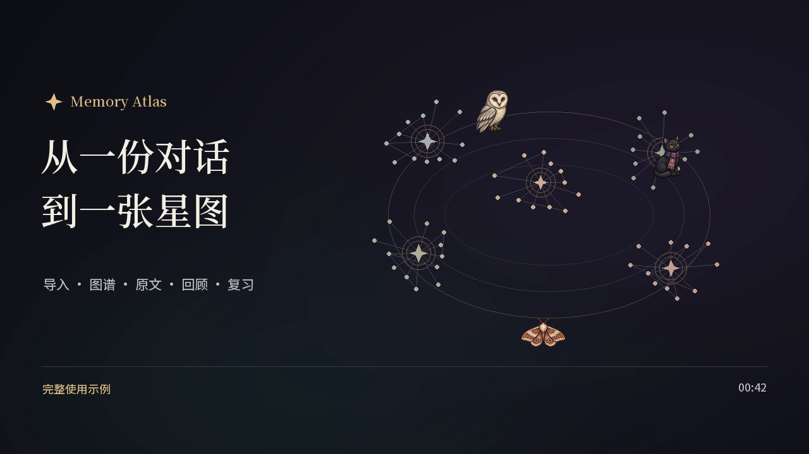
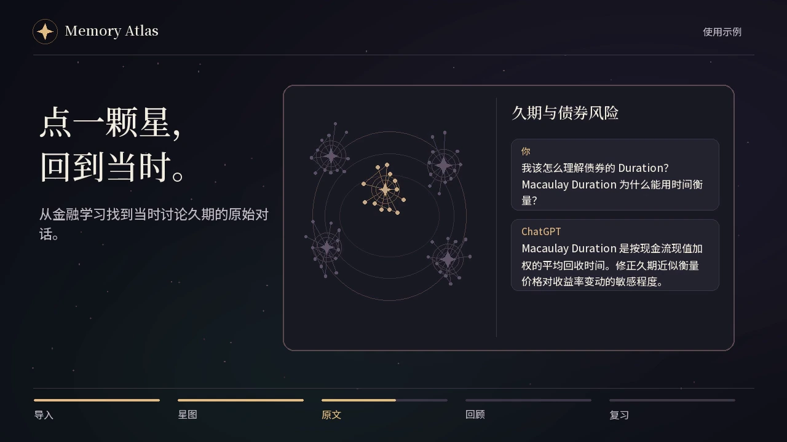
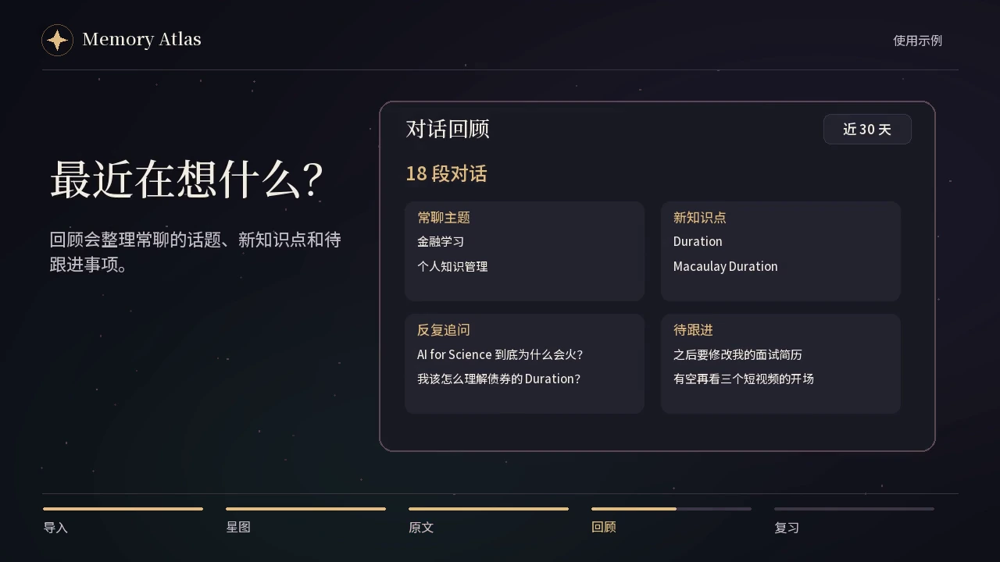

# Memory Atlas · 对话星图

> 聊过的，隔一阵也能循着线索找回来。

你可能记得自己问过一个关于久期的问题，却忘了当时卡在公式还是直觉。重读的时候，那句追问有时比答案更值得留意。它记录了当时想不通的地方，也让人看见后来理解变了多少。

Memory Atlas 把与 ChatGPT 的对话按主题组织起来。点开星图里的节点，可以回到当时说过的话。想留下自己的理解，可以写进回顾。想知道过几天还记不记得，可以把它放进复习卡。

## 42 秒使用示例

短片用站内的 18 段示例对话演示文件导入、主题图谱、原文回看、对话回顾与复习卡。画面为流程动画，配有原创轻音乐和可选中文字幕。 [打开 MP4](dist/media/atlas-walkthrough.mp4)

## 从一颗星回到一句话

在示例图谱里，「金融学习」连着债券久期、逆向选择和杠杆收购。点开「久期与债券风险」，会看到提问从「久期是什么」走到了「为什么能用时间衡量」。图上的线帮你找到这段话，原文保留当时的问题。

星图支持缩放、拖动、搜索和日期筛选，也可以切到时间轴。首页的像素桌宠能打开主题、时间轴或对话回顾。

## 回顾这一段时间

回顾按近 7 天、近 30 天或具体月份整理线索。常聊的主题告诉你时间花在了哪里，反复出现的追问提示你哪些地方仍然没有想通。可以打开摘录核对原文，再为这个月写几句自己的理解。

如果一段对话值得再读，把其中的知识点加入复习。复习时先想一遍，再展开原文核对。选择「记住了」「有点模糊」或「还没记住」后，应用按反馈安排下一次回看。

## 本地运行

用 Python 3 启动静态服务，再用现代浏览器打开 http://127.0.0.1:8010/。

~~~sh
python -m http.server 8010 --bind 127.0.0.1 --directory dist
~~~

1. 在 ChatGPT 设置的「数据控制」里导出数据，或复制一段对话。
2. 打开 Memory Atlas，点「导入对话」。支持导出的 ZIP、JSON、HTML、TXT、Markdown 和粘贴文本。
3. 在主题或节点详情查看来源。想根据时间追踪，就切到时间轴。
4. 打开「回顾」查看原文摘录并写复盘，或把知识点加入「复习」。
5. 需要迁移时，在「本地档案 → 管理对话与备份」下载备份。备份包括原文、笔记、复习记录和回收站。

导入支持分片导出。ZIP 上限为 512 MB，会跳过附件，读取的对话文字合计上限为 80 MB。单个普通文本文件上限为 80 MB。

如需实时同步，可以按扩展说明安装 Chrome / Edge 扩展。采集按对话开启，只读取当前页面已加载的文字。自行部署时，在扩展里替换目标站点域名。 [扩展安装和采集边界](extension/README.md)

## 数据留在哪里

导入、分析和保存都在当前浏览器里完成。Worker 用双语 TF-IDF、术语归一和增量余弦聚类整理对话，以球面 K-means 作对照。档案由 IndexedDB 保存，页面通过版本检查处理多标签页写入。运行无需 API Key。

关闭「保留原文」会留下标题、关键词和用于导航的短句。备份是明文 JSON，可以跨设备恢复，也值得保管好。仓库和短片使用项目内置的示例数据。

自动生成的主题、摘录和待办可以回到来源核对。轮廓系数衡量分组的分离程度，学习摘录取自对话原句。多少内容真正变成了自己的理解，还是要靠回忆和验证。

## 源码与验证

| 路径 | 内容 |
| --- | --- |
| [dist/](dist/) | 静态网站、图谱、导入 Worker 与本地档案 |
| [dist/media/](dist/media/) | 42 秒短片、封面和中文字幕 |
| [extension/](extension/) | 可选的 Chrome / Edge 对话采集扩展 |
| [scripts/render-walkthrough.py](scripts/render-walkthrough.py) | 从内置示例生成短片画面和配乐 |
| [test/](test/) | 导入、分支解析、备份、复习调度及扩展协议的测试 |

~~~sh
npm test
python scripts/package-downloads.py
~~~

短片渲染脚本需要 Pillow、NumPy、FFmpeg 和 Noto Sans SC / Noto Serif SC 可变字体，路径可通过命令行参数指定。网站运行时使用本地托管的字体子集。 [字体许可](dist/fonts/OFL.txt)

项目代码采用 MIT 许可。 [LICENSE](LICENSE)
